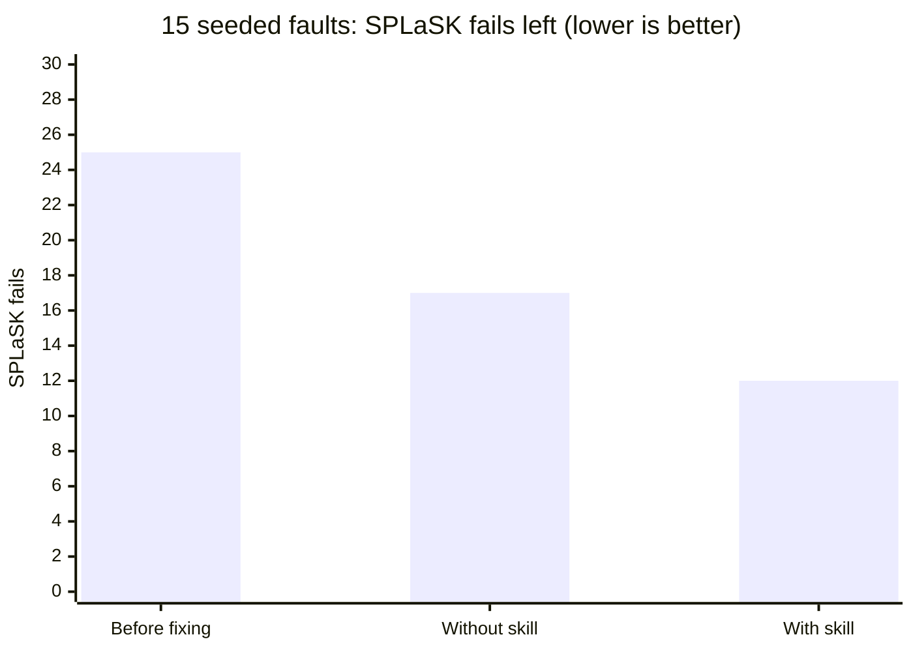
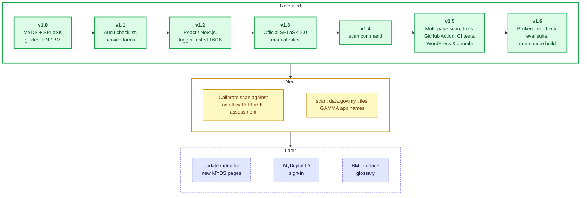

<a id="top"></a>
<div align="center">

<picture>
  <source media="(prefers-color-scheme: dark)" srcset="assets/banner-dark.svg">
  
</picture>

**A Claude skill for building and auditing Malaysian public-sector websites against MYDS and SPLaSK 2.0**

<p>
  <a href="https://github.com/DexComm69/malaysia-gov-web-guidance/releases/latest"></a>
  <a href="https://github.com/DexComm69/malaysia-gov-web-guidance/stargazers"></a>
  <a href="https://github.com/DexComm69/malaysia-gov-web-guidance/commits/main"></a>
  <a href="LICENSE"></a>
  <a href="https://github.com/DexComm69/malaysia-gov-web-guidance/actions/workflows/selftest.yml"></a>
</p>
<p>
  
  
  
  
  
</p>

English · [Bahasa Melayu](#bahasa-melayu)

</div>

> [!IMPORTANT]
> **Unofficial project.** This skill is not developed, endorsed or maintained by Jabatan Digital Negara (JDN), GovTech Malaysia or any government agency. It summarises and links to the official sources, and **the official sources take precedence** wherever they differ: [design.digital.gov.my](https://design.digital.gov.my) for MYDS, and your agency's SPLaSK supervisor for SPLaSK.

<p align="center">
  <a href="#overview"><b>Overview</b></a> ·
  <a href="#features"><b>Features</b></a> ·
  <a href="#installation"><b>Installation</b></a> ·
  <a href="#usage"><b>Usage</b></a> ·
  <a href="#coverage"><b>Coverage</b></a> ·
  <a href="#sources-and-accuracy"><b>Sources</b></a> ·
  <a href="#validation"><b>Validation</b></a> ·
  <a href="#limitations"><b>Limitations</b></a> ·
  <a href="#roadmap"><b>Roadmap</b></a> ·
  <a href="#contributing"><b>Contributing</b></a> ·
  <a href="#bahasa-melayu"><b>Bahasa Melayu</b></a>
</p>

## Overview&nbsp;

Official Malaysian public-sector websites, from ministries to local councils, are expected to meet two standards:

<table>
  <tr>
    <td valign="top" width="50%">

### MYDS&nbsp;
**Malaysia Government Design System**<br>
<sub>GovTech Malaysia / JDN</sub>

Official masthead, colour tokens, Poppins/Inter typography, the 12-8-4 grid and accessible components.

</td>
    <td valign="top" width="50%">

### SPLaSK 2.0&nbsp;
**Sistem Pemantauan Laman Web dan Servis Kerajaan**<br>
<sub>JDN</sub>

25 criteria across 6 dimensions, assessed by an automated crawler that detects most criteria through `splwpk-*` HTML attributes.

</td>
  </tr>
</table>

Neither standard is well represented in general-purpose AI models. Without guidance, models invent SPLaSK tag names that the crawler will never match, and paraphrase the official masthead text. **This skill gives Claude the official rules, the MYDS documentation and the tools to check its own output.**

## Features&nbsp;

<table>
  <tr>
    <td align="center" valign="top" width="20%"><h2>25</h2>SPLaSK 2.0 criteria</td>
    <td align="center" valign="top" width="20%"><h2>~115</h2>MYDS pages, read live</td>
    <td align="center" valign="top" width="20%"><h2>10</h2>hand-written guides</td>
    <td align="center" valign="top" width="20%"><h2>18 / 18</h2>trigger tests passed</td>
    <td align="center" valign="top" width="20%"><h2>BM · EN</h2>bilingual throughout</td>
  </tr>
</table>

<table>
  <tr>
    <td valign="top" width="33%">

### Guidance&nbsp;

- **Official SPLaSK 2.0 rules** from JDN's tagging manual and user manuals: placement, timestamps, freshness windows, SEO limits, crawler access.
- **MYDS documentation**, searchable in English and Malay and fetched live from design.digital.gov.my.
- **Ready-made patterns:** masthead, BM/EN switch, public forms with PDPA notice, status lookups, audits.
- **Works with any stack:** plain PHP / HTML / Blade, or React / Next.js.

</td>
    <td valign="top" width="33%">

### Tooling&nbsp;

- **`scan`:** a SPLaSK 2.0 pre-check of the home page and any pages you pick, with a fix for every failure. Reads the server HTML the way the crawler does.
- **GitHub Action:** runs `scan` on every push and writes the report to the job summary.
- **`check-classes`:** catches CSS classes that MYDS doesn't define, in PHP, Blade or JS-built markup.
- **`tokens`:** every MYDS colour token with its light and dark value.
- **`search` / `retrieve` / `prefetch`**, with retries and an offline cache.
- Python 3.8+, standard library only.

</td>
    <td valign="top" width="33%">

### Behaviour&nbsp;

- **Asks before deciding** conflicts, such as agency branding versus MYDS colours.
- **Never invents facts** the rules depend on, like URLs or dates; it leaves TODOs instead.
- **Asks the report language** (BM, English or both) before writing one.
- **Shows its work:** every answer ends with a *Panduan Web Kerajaan* section listing the rules applied and any open items.

</td>
  </tr>
</table>

## Installation&nbsp;

<p align="center">
  <a href="https://github.com/DexComm69/malaysia-gov-web-guidance/releases/latest/download/malaysia-gov-web-guidance.skill"></a>
  <a href="#claude-code-plugin"></a>
  <a href="https://github.com/DexComm69/malaysia-gov-web-guidance/releases"></a>
</p>

<details open>
<summary><b>Claude app</b>  <sub>claude.ai · desktop · mobile</sub></summary>

<br>

1. **[Download `malaysia-gov-web-guidance.skill`](https://github.com/DexComm69/malaysia-gov-web-guidance/releases/latest/download/malaysia-gov-web-guidance.skill)** (always the latest release).
2. Open it in Claude and select **Save skill**, or upload it under **Settings → Capabilities → Skills**.
3. Make sure **code execution** is turned on, because the skill runs a small Python script.

</details>

<details open>
<summary><b>Claude Code: plugin</b>  <sub>recommended</sub></summary>

<a id="claude-code-plugin"></a>

```text
/plugin marketplace add DexComm69/malaysia-gov-web-guidance
/plugin install malaysia-gov-web-guidance@malaysia-gov-web-guidance
```

Update later with `/plugin marketplace update malaysia-gov-web-guidance`.

</details>

<details>
<summary><b>Claude Code: manual</b>  <sub>copy the folder</sub></summary>

<br>

```sh
git clone https://github.com/DexComm69/malaysia-gov-web-guidance.git
cp -r malaysia-gov-web-guidance/skills/malaysia-gov-web-guidance ~/.claude/skills/        # all projects
# or: cp -r … <your-project>/.claude/skills/                                                # one project
```

</details>

> [!NOTE]
> **Requirements:** Python 3.8 or later (standard library only). Network access the first time each MYDS page is read; pages are then cached for 7 days.

> [!TIP]
> Working offline or on a slow agency network? Run `python scripts/mgwg.py prefetch all` once to cache every MYDS page.

## Usage&nbsp;

### With Claude

The skill activates automatically for Malaysian public-sector work. Try:

<table>
  <tr>
    <td width="50%"><i>"Build a staff login page in plain PHP for our council portal, following government design rules."</i></td>
    <td width="50%"><i>"Create header.php and footer.php for our agency site. It must pass SPLaSK, with BM by default and an EN switch."</i></td>
  </tr>
  <tr>
    <td><i>"Our portal failed SPLaSK last month. Fix index.html."</i></td>
    <td><i>"Semak index.html ini untuk pematuhan MYDS dan SPLaSK."</i></td>
  </tr>
</table>

### Command line

```sh
cd skills/malaysia-gov-web-guidance
python scripts/mgwg.py scan https://www.example.gov.my --list-pages      # see which pages can be scanned
python scripts/mgwg.py scan https://www.example.gov.my --pages all       # home + every page found
python scripts/mgwg.py scan https://www.example.gov.my --pages 1,3       # or by number, name or URL
python scripts/mgwg.py scan https://www.example.gov.my --pages all --check-links   # also test every link
```

| Command | What it does |
|---|---|
| **`scan`** `<url-or-file> [--list-pages] [--pages …] [--check-links [all]] [--format text\|json\|md] [--fail-on fail\|warn]` | SPLaSK 2.0 pre-check of the home page and the pages you choose: `all`, numbers, names (`privacy,sitemap`) or URLs. `--check-links` tests every link for broken ones (Active Link). Every FAIL comes with a fix |
| **`search`** `"<query>"` | Rank guides for a task (English or Malay) |
| **`retrieve`** `<id>[,<id>] [--lang en\|ms\|both]` | Print guides; MYDS pages are fetched live |
| **`list`** `[--category <name>]` | List all guides |
| **`check-classes`** `<files> [--css <file>]` | Find CSS classes not defined by MYDS 1.0.0 |
| **`tokens`** `[--filter <prefix>]` | List MYDS theme tokens with light and dark values |
| **`prefetch`** `all\|<category>\|<ids>` | Cache MYDS pages for slow or offline use |

<details>
<summary><b>Example <code>scan</code> output</b></summary>

```text
FAIL  Tag spelling            `splwpk-search-funtion` is not an official tag; did you mean `splwpk-search-function`?
FAIL  Feedback Form           `splwpk-feedback-form` is on an <i> element (1x); tag the link/element itself
FAIL  Commented-out tags      tags that exist only inside HTML comments <!-- --> (switched off): splwpk-sitemap
FAIL  Updated Content: News   newest timestamp 2024-11-02 is 752 days old (limit 30)
FAIL  SEO                     <title> is 94 characters (must be under 70)
                              -> fix: <title>Agency name, short (under 70 characters)</title>
FAIL  Privacy Policy          [privacy] privacy page heading is not tagged
                              -> fix: <h1 splwpk-privacy-policy="splwpk-privacy-policy">Dasar Privasi</h1>
WARN  Sitemap                 `splwpk-sitemap` is not on the home page but is on "sitemap" (https://…/peta-laman)
                              -> fix: register https://…/peta-laman as a Criteria URL for this tag in the SPLaSK site profile
PASS  Updated Content: About Us  `splwpk-about-us` found (1x); newest timestamp 2026-11-10, 14 days old (limit 30)
```

</details>

### GitHub Action

Check a site on every push, or on a schedule. The Markdown report appears in the job summary, and the step fails when `scan` finds a FAIL.

```yaml
# .github/workflows/splask.yml
on:
  push:
  schedule: [{ cron: '0 0 * * 1' }]   # every Monday
jobs:
  splask:
    runs-on: ubuntu-latest
    steps:
      - uses: DexComm69/malaysia-gov-web-guidance@v1.6.0
        with:
          url: https://www.example.gov.my
          pages: all            # or privacy,sitemap / 1,3 / URLs; empty = home page only
          fail-on: fail         # fail | warn | never
```

## Coverage&nbsp;

<table>
  <tr>
    <td valign="top" width="33%">

#### SPLaSK&nbsp;
- `splask-overview`: scope and the 6 dimensions
- `splask-tagging`: every `splwpk-*` tag
- `splask-criteria-checklist`: all 25 criteria
- `splask-operations`: crawler access, Criteria URL, assessments

</td>
    <td valign="top" width="33%">

#### Patterns&nbsp;
- `masthead-html`: official masthead, exact BM/EN text
- `service-form-pattern`: public forms and lookups
- `myds-plain-html-php`: MYDS without React
- `myds-react-nextjs`: React, JSX tags, BM/EN routing

</td>
    <td valign="top" width="33%">

#### Review and MYDS docs&nbsp;
- `audit-checklist`: reviewing an existing site
- `cms-wordpress-joomla`: tags and masthead on WordPress and Joomla
- `design-*`: ~40 MYDS design pages
- `develop-*`: ~75 MYDS development pages, read live from design.digital.gov.my

</td>
  </tr>
</table>

## Sources and accuracy&nbsp;

| Source | Used for |
|---|---|
| *Manual Tagging SPLaSK V2.0*, JDN | Tags, criteria, conditions and crawler rules |
| *Manual Penggunaan SPLaSK* (Webmaster, Supervisor), JDN | Operations: access, site profile, assessments |
| [design.digital.gov.my](https://design.digital.gov.my) and [github.com/govtechmy/myds](https://github.com/govtechmy/myds) | MYDS documentation, tokens, components |
| SPLaSK pages on malaysia.gov.my and jdn.gov.my | Background and the GOS criteria |

The official manuals are summarised in this project's own words and are not redistributed; ask your agency's SPLaSK supervisor or JDN for copies. The full source list and known discrepancies are in [`references/sources.md`](skills/malaysia-gov-web-guidance/references/sources.md).

## Validation&nbsp;

Each release is tested by having Claude complete realistic tasks **with and without the skill**.



| Test | Result | |
|---|---|---|
| Trigger test: 18 prompts in English, BM and Manglish | Activated for all 9 government tasks, none of the 9 near-misses |  |
| Next.js page with MYDS React components | All 11 imports matched the published `@govtechmy/myds-react` exports |  |
| Public PHP application form, built from scratch | Exact masthead wording, correct tags, accessible validation |  |
| Review of a 7-role staff system | 63 page and role combinations covered; skill issues fixed in 1.1.0 |  |
| `scan` on 5 live government portals | Real issues found (misspelled tags, tags in HTML comments, stale timestamps); false alarms fixed |  |
| Seeded-fault page (chart above) | 25 → 12 fails with the skill; without it, 25 → 17 and two invented tag names |  |
| WordPress child theme, 5 pages, 15 seeded faults | 27 → 11 fails with the skill (all 11 need real council URLs); without it, 27 → 22 and three invented tag names |  |
| [Eval suite](skills/malaysia-gov-web-guidance/evals/BASELINE.md): 13 checks over both seeded-fault tasks | Official tags only, form placement, no invented dates, SEO limits, Criteria URL steps |  |

See [`CHANGELOG.md`](CHANGELOG.md) for details.

## Limitations&nbsp;

> [!WARNING]
> - `scan` is a **pre-check**. It hasn't yet been calibrated against an official SPLaSK on-demand assessment, which remains the only authoritative score.
> - `scan` only follows links from the home page (or the URLs you give it) and doesn't run JavaScript. It doesn't yet check data.gov.my dataset titles or GAMMA app names.
> - The GOS (online service) criteria come from the older criteria diagram on malaysia.gov.my, not from the v2.0 tagging manual.
> - The MYDS page index reflects the documentation as of November 2026.
> - A few terse manual rules are interpreted conservatively (for example "under 70 characters" for titles).

## Roadmap&nbsp;



<sub><b>Green</b>: released · <b>Amber</b>: next up · <b>Blue, dashed</b>: planned. Full history in [CHANGELOG.md](CHANGELOG.md). Suggestions are welcome as [issues](https://github.com/DexComm69/malaysia-gov-web-guidance/issues).</sub>

## Contributing&nbsp;

Issues and pull requests are welcome. The most useful contributions:

<table>
  <tr>
    <td valign="top" width="33%"><b>Corrections</b><br><sub>confirmed against an official JDN or GovTech source</sub></td>
    <td valign="top" width="33%"><b>Updates</b><br><sub>changes in MYDS (new pages, renamed tokens) or a newer SPLaSK manual</sub></td>
    <td valign="top" width="33%"><b>Bahasa Melayu</b><br><sub>clearer or more formal Malay wording in the guides</sub></td>
  </tr>
</table>

> [!TIP]
> Guides in `guides/gov/` keep an English and a Bahasa Melayu section, cite an official source, and record a `retrieved:` date.
> Before a pull request, run the tests: `python -m unittest discover -s skills/malaysia-gov-web-guidance/tests`, and check the build with `python tools/build.py --check`.
> To measure the skill's effect on real tasks, run its eval suite from `skills/malaysia-gov-web-guidance`: `claude plugin eval . --scaffold --allow-tools Write,Edit,Bash`. Each case runs with and without the skill; these are billed model runs. The CLI needs a shell sandbox, so run it on macOS, Linux or WSL (see [`evals/BASELINE.md`](skills/malaysia-gov-web-guidance/evals/BASELINE.md)).

## Licence&nbsp;

Released under the [MIT Licence](LICENSE). The licence covers this repository's own files only; see [NOTICE](NOTICE). MYDS and SPLaSK materials belong to GovTech Malaysia and JDN and are not included. "MYDS", "SPLaSK", "JDN" and "GovTech Malaysia" are used only to identify the official sources.

---

## Bahasa Melayu

**Skill Claude untuk membina dan mengaudit laman web sektor awam Malaysia mengikut MYDS dan SPLaSK 2.0.**

> [!IMPORTANT]
> **Projek tidak rasmi.** Skill ini tidak dibangunkan, disahkan atau diselenggara oleh Jabatan Digital Negara (JDN), GovTech Malaysia atau mana-mana agensi kerajaan. **Sumber rasmi diutamakan** sekiranya terdapat perbezaan: [design.digital.gov.my](https://design.digital.gov.my) bagi MYDS, dan *supervisor* SPLaSK agensi anda bagi SPLaSK.

### Gambaran keseluruhan&nbsp;

Laman web rasmi sektor awam perlu mematuhi **MYDS** (*masthead* rasmi, token warna, fon Poppins/Inter, grid 12-8-4, komponen mesra OKU) dan **SPLaSK 2.0** (25 kriteria dalam 6 dimensi, dinilai oleh *crawler* yang mengesan kebanyakan kriteria melalui atribut HTML `splwpk-*`). Skill ini membekalkan Claude dengan peraturan rasmi, dokumentasi MYDS dan alat semakan.

### Ciri utama&nbsp;

- Panduan dalam BM dan BI: kira-kira 115 halaman MYDS (dibaca terus dari laman rasmi) dan 10 panduan SPLaSK, corak laman kerajaan serta WordPress/Joomla.
- Peraturan SPLaSK berdasarkan *Manual Tagging SPLaSK V2.0* dan manual pengguna SPLaSK (JDN).
- Arahan `scan`: semakan awal SPLaSK 2.0 bagi halaman utama dan halaman yang anda pilih (`--pages all`, nombor, nama atau URL), dengan cadangan pembetulan bagi setiap FAIL. Boleh dijalankan sebagai GitHub Action.
- Sokongan PHP / HTML / Blade dan React / Next.js.
- Bertanya dahulu apabila berlaku konflik, tidak mereka maklumat, dan menyenaraikan perkara pematuhan yang belum selesai dalam bahagian *Panduan Web Kerajaan*.

### Pemasangan&nbsp;

- **Aplikasi Claude:** muat turun `malaysia-gov-web-guidance.skill` daripada [*release* terkini](https://github.com/DexComm69/malaysia-gov-web-guidance/releases/latest), buka dalam Claude dan pilih **Save skill**.
- **Claude Code:**
  ```text
  /plugin marketplace add DexComm69/malaysia-gov-web-guidance
  /plugin install malaysia-gov-web-guidance@malaysia-gov-web-guidance
  ```
- Memerlukan Python 3.8 ke atas, dan akses internet kali pertama setiap halaman MYDS dibaca.

### Had&nbsp;

- `scan` ialah semakan awal dan belum dikalibrasi dengan penilaian *On-Demand* SPLaSK yang rasmi.
- Kriteria GOS diambil daripada rajah kriteria lama di malaysia.gov.my.

### Lesen&nbsp;

[MIT](LICENSE), bagi fail repositori ini sahaja. Bahan MYDS dan SPLaSK adalah milik GovTech Malaysia dan JDN.

---

<p align="center">
  <sub>Unofficial · built for the Malaysian public sector · <a href="#top">back to top ↑</a></sub>
</p>
